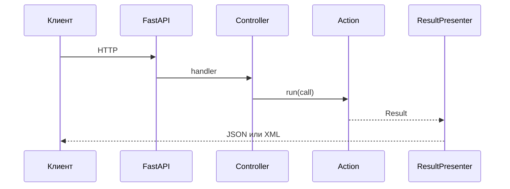

## Описание

`pymvc-fastapi` — обвязка FastAPI вокруг pymvc. Из `Request` собирается `Call`, контроллер вызывает `Action`, `ResultPresenter` отдаёт JSON, XML или файл. В пакете же журнал HTTP, статистика, обработчик ошибок, лимиты запросов, загрузка файлов и клиент к другим сервисам. К базе пакет не ходит.

## Процедуры БД

Процедур базы данных в пакете нет.

## Схема работы

## Сценарии

### HTTP-запрос к действию

1. Клиент шлёт HTTP-запрос в FastAPI.
2. Из `Request` собирается `Call` (запрос, IP, User-Agent).
3. Контроллер вызывает `Action.run(call)`.
4. Действие возвращает `Result`.
5. `ResultPresenter` отдаёт клиенту JSON, XML или файл.

MVC FastAPI implementation